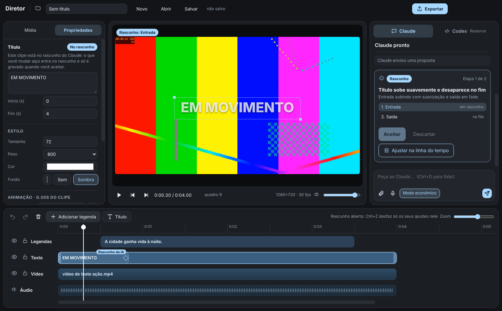

# Diretor

Editor de vídeo para Windows com foco em motion graphics, feito para editar à mão **e** colaborar com a IA na mesma linha do tempo. Você conversa com o Claude (ou o Codex) no próprio painel do Diretor, por texto, voz ou imagem, e pede em linguagem natural (com detalhes, “do frame 15 ao 45”, ou sem detalhes, “faz do melhor jeito”) e vê cada etapa aparecer como **rascunho editável** na prévia e na linha do tempo. Você ajusta à mão, aceita ou descarta. Nada é gravado sem a sua aprovação.



## Tecnologia (por quê)

- **Electron + React + TypeScript.** Roda no Windows com uma única base de código, e a prévia usa o Chromium, que decodifica H.264 e desenha texto com qualidade.
- **Um único compositor (`src/core/render.ts`).** A prévia e a exportação usam o mesmo código de desenho no mesmo motor, então enquadramento, tempo, legendas e animação saem iguais. O teste automático compara prévia e MP4 quadro a quadro.
- **ffmpeg local** (pacote `ffmpeg-static`) só para ler os vídeos, codificar o MP4 (H.264, cores BT.709) e misturar o áudio aparado do original. Nada é enviado para a internet.
- **Chat com o Claude Code e o Codex instalados no computador**, usando a sua assinatura (Claude Pro/Max, ChatGPT Plus). Sem chave de API, sem créditos próprios, sem cobrança por comando. O Diretor não guarda senha nem token: o login fica nos próprios programas.
- **MCP local (stdio)**: o mesmo servidor serve o chat do painel e o Claude Desktop.

## Baixar a versão de teste (Windows)

**[Diretor-Setup.exe](https://github.com/teste652/Diretor/releases/download/teste/Diretor-Setup.exe)**: sempre a versão mais nova da `main`, sem precisar de Node, Git nem comandos. O repositório é privado, então abra o link com a sua conta do GitHub conectada no navegador. Notas de cada versão: [versão de teste](https://github.com/teste652/Diretor/releases/tag/teste).

1. Baixe o `Diretor-Setup.exe`. O instalador ainda não tem assinatura digital, então o navegador pode avisar que o arquivo não é baixado com frequência. No Edge: três pontinhos ao lado do download → **Manter** → **Mostrar mais** → **Manter mesmo assim**. No Chrome: **Manter**.
2. Abra o arquivo. Se o Windows avisar “O Windows protegeu o computador”, clique em **Mais informações → Executar assim mesmo**. Se ele bloquear sem mostrar essa opção, é o Controle Inteligente de Aplicativos, que barra programas sem assinatura digital: por enquanto o Diretor não instala nesse computador.
3. Ele instala sozinho, só para o seu usuário (em `%LOCALAPPDATA%\Programs`, sem pedir senha de administrador), cria o atalho no menu Iniciar e abre o Diretor. O ffmpeg e o servidor do Claude vêm dentro dele.
4. O Diretor se atualiza sozinho: ao abrir, e a cada quatro horas, ele procura versão nova no mesmo link (o arquivo `latest.yml` ao lado do instalador), baixa e pergunta se pode reiniciar; se a pessoa escolher "Depois", a versão nova entra quando ela fechar o Diretor. O que aconteceu fica em `atualizacao.log`, na pasta de dados do app (`%APPDATA%\Diretor`). Para isso, o link precisa abrir sem login no GitHub (repositório público). Para atualizar à mão: salve o projeto, feche o Diretor, baixe de novo pelo mesmo link e instale por cima (se o Diretor estiver aberto, o instalador pede para salvar e fechar; ele nunca fecha o editor à força). Se o Claude Desktop estava conectado, o instalador avisa no fim para fechá-lo por completo e abrir de novo. A versão instalada aparece ao lado do nome, no canto superior esquerdo.

Para desinstalar: **Configurações do Windows → Aplicativos → Diretor → Desinstalar**. O Diretor sai também da configuração do Claude Desktop (só a entrada desta instalação). Se ele estava conectado e o Claude Desktop estiver aberto, o desinstalador pede antes para fechá-lo, porque aberto ele pode gravar a configuração antiga de volta.

O GitHub Actions gera esse instalador a cada mudança na `main`, instala, roda nele o roteiro de ponta a ponta inteiro, testa instalar por cima e desinstalar, e só então troca o arquivo do link.

## Instalação para desenvolver (Windows)

Requisitos: [Node.js 22.12 ou mais novo](https://nodejs.org) (a versão LTS atual serve) e Git.

```powershell
git clone https://github.com/teste652/Diretor.git
cd Diretor
npm install
npm start
```

`npm start` compila e abre o editor (na primeira vez, baixa o Electron, uns 100 MB). Para desenvolver com recarga automática: `npm run dev`.

O `npm install` baixa o ffmpeg para Windows x64. Em Windows ARM (ou se a rede bloquear o download) a instalação continua sem ele: instale o ffmpeg, deixe-o no PATH ou aponte a variável `DIRETOR_FFMPEG` para o `ffmpeg.exe`. O editor avisa se não encontrar o ffmpeg.

Para gerar o instalador no seu computador: `npm run dist` (no Windows; sai em `release\Diretor-Setup.exe`). O ícone fica em `build/`. Para redesenhá-lo a partir de `build/icon.svg`: `npx playwright-core install chromium` (uma vez) e `node scripts/make-icon.mjs`.

## Conversar com a IA dentro do Diretor

O painel da direita é um chat. Escreva o pedido (“anima o título entrando de baixo”, “legenda do segundo 2 ao 5 dizendo…”) e aperte Enter: a IA lê o projeto, propõe a edição e ela aparece como **rascunho** na prévia e na linha do tempo, para você aceitar, ajustar ou descartar. A resposta aparece no próprio painel.

- **Claude** (aba principal) usa o **Claude Code** instalado no computador, com o seu plano Pro ou Max. **Codex** (aba “Reserva”) usa o **Codex** da OpenAI, com o seu plano do ChatGPT. Os dois funcionam do mesmo jeito.
- **Não tem instalado?** O painel mostra o botão **Instalar**: abre uma janela do PowerShell que instala pelo instalador oficial (Claude Code) ou pelo npm (Codex, que precisa do [Node.js](https://nodejs.org/pt)) e em seguida pede para entrar na sua conta. Depois é só voltar para o Diretor. Se o login expirar, o erro no chat vem com o botão **Entrar na conta**.
- **Voz:** **Ctrl+D** (ou o microfone) abre o ditado por voz do Windows (o mesmo do Windows+H) na caixa do chat. Fale e aperte Enter.
- **Imagem:** cole (Ctrl+V), arraste para o painel ou use o clipe. A imagem vai junto com a mensagem como referência (estilo, cores, texto).
- **Parar** interrompe a resposta. **Nova conversa** começa do zero (a IA esquece o que foi dito; o projeto fica igual). A conversa continua quando você abre o Diretor de novo.
- Enquanto a IA trabalha, o que você escrever vira uma nota que ela lê na próxima consulta ao editor.

Como funciona: para cada mensagem, o Diretor roda `claude -p` (ou `codex exec`) numa pasta vazia do próprio Diretor, retomando a mesma conversa, com um único conector, o servidor MCP do Diretor. O Claude Code roda sem nenhuma outra ferramenta (`--tools ""`, `--strict-mcp-config`); o Codex roda com o conector aprovado, sem terminal e sem poder mexer em arquivos (`--disable shell_tool`, `--sandbox read-only`). O Codex instalado pelo npm roda direto pelo `codex.exe` do pacote, sem abrir janela. Nada passa por servidores do Diretor. Para testar com outro programa, as variáveis `DIRETOR_CLAUDE_CLI` e `DIRETOR_CODEX_CLI` apontam o executável (o teste automático usa `scripts/ia-simulada.mjs`).

## Conectar ao Claude Desktop

Opcional: se preferir conversar no Claude Desktop, clique em **Usar pelo Claude Desktop**, no alto do chat, e siga os passos abaixo.

1. Abra o Claude Desktop pelo menos uma vez neste computador.
2. Feche o Claude Desktop por completo: botão direito no ícone dele, perto do relógio (ou dentro da setinha **^** ao lado, onde ficam os ícones escondidos), e **Sair**. Fechar a janela não basta. Aberto, ele pode regravar a configuração e desfazer a mudança.
3. No Diretor, no painel do Claude (à direita), clique em **Conectar**.
4. Abra o Claude Desktop de novo. O conector “diretor” aparece na lista de ferramentas.
5. Deixe o editor aberto. O painel mostra “Claude Desktop conectado”, ao lado de “Usar pelo Claude Desktop”, quando o Claude Desktop usa as ferramentas.

O botão grava o servidor “diretor” no `claude_desktop_config.json` do Claude Desktop e mantém o resto do arquivo (outros servidores e preferências). Na primeira vez, guarda uma cópia do arquivo como estava em `claude_desktop_config.antes-do-diretor.json`, na mesma pasta (as vezes seguintes não substituem essa cópia). Arquivo com erro de formato não é tocado: o editor avisa e mostra onde ele está, para corrigir o erro; depois disso o botão volta. O servidor roda com o próprio `Diretor.exe` (`ELECTRON_RUN_AS_NODE=1`), então não precisa do Node.

Onde o Claude Desktop guarda a configuração no Windows, e onde o botão grava (para cada Claude Desktop instalado, a mesma escolha que ele faz):

- **Claude Desktop 4** (o atual): `%LOCALAPPDATA%\Claude-Data\claude_…`. Ao mudar para essa pasta, o Claude deixa na pasta antiga do pacote só uma marca (`.user-data-left.…`) e não lê mais nada dela, então o botão não grava lá. Um arquivo velho em `%APPDATA%\Claude` também fica como está.
- **Instalador da Microsoft Store/MSIX mais antigo** (ou quando a mudança para a Claude-Data foi desfeita): `%LOCALAPPDATA%\Packages\Claude_…\LocalCache\Roaming\Claude`. Quando essa pasta ainda não tem o arquivo, o Claude lê o de `%APPDATA%\Claude`, e o botão grava nesse, sem criar uma cópia que esconderia os outros servidores.
- **Instalação clássica** (em `%LOCALAPPDATA%\AnthropicClaude`): `%APPDATA%\Claude`.

**À mão:** “Copiar configuração”, no mesmo painel, copia o trecho com os caminhos certos deste computador. Cole dentro de `claude_desktop_config.json` (se já houver outros servidores em `mcpServers`, só acrescente `"diretor"`). No app instalado, fica assim:

```json
{
  "mcpServers": {
    "diretor": {
      "command": "C:\\Users\\voce\\AppData\\Local\\Programs\\diretor\\Diretor.exe",
      "args": ["C:\\Users\\voce\\AppData\\Local\\Programs\\diretor\\resources\\app.asar.unpacked\\dist\\mcp\\server.cjs"],
      "env": { "ELECTRON_RUN_AS_NODE": "1" }
    }
  }
}
```

Na cópia de desenvolvimento, o botão grava o Electron do projeto no lugar do `Diretor.exe`; `npm run build` e depois `npm run mcp:config` imprimem o trecho (também numa versão com `node`). Se for colar à mão, use o arquivo que o próprio Claude abre em **Configurações → Desenvolvedor → Editar configuração**, com o Claude fechado na hora de salvar.

Como funciona: o Claude Desktop inicia `server.cjs`; ele conversa com o editor aberto por uma ponte em `127.0.0.1` protegida por um token aleatório (arquivo `%LOCALAPPDATA%\Diretor\bridge.json`). O editor funciona normalmente sem a IA.

### Ferramentas que o Claude recebe

| Ferramenta | O que faz |
|---|---|
| `get_context` | Lê revisão, seleção (clipes compactos, com keyframes) e playhead. Mínimo por padrão; `knownRevision` reaproveita o que o Claude já tem. |
| `propose_edit` | Envia uma proposta em **etapas** (ex.: “Entrada”, “Saída”). Cada etapa vira rascunho, uma por vez. `requestId` torna a chamada idempotente. |
| `get_proposal` | Mostra o que você decidiu (aceitou, ajustou, descartou) e as notas que você escreveu no painel. Pode esperar até 45 s por uma decisão (abaixo do limite de ~60 s do Claude Desktop). Se você parar o Claude no meio da espera, o editor desiste na hora e a sua nota fica para a próxima chamada. |
| `cancel_proposal` | Cancela uma proposta pendente. |
| `editor_status` | Confere se o editor está aberto. |

As operações são as mesmas que a interface usa (`src/core/operations.ts`): `animate` (presets que viram keyframes editáveis), `setKeyframe`, `retimeGroup`, `setProperty`, `addClip`, `updateClip`, `trimClip` (aparar como nas bordas do clipe), `splitClip` (dividir um clipe num ponto), `removeRanges` (apagar trechos de todas as faixas, fechando o buraco), `removeClip` etc. O editor valida alvo, parâmetros (tipos, faixas, campos desconhecidos: um campo com nome errado é recusado, não ignorado), intervalo e revisão antes de mostrar qualquer coisa. Importar mídia e mexer nas faixas ficam só na interface. E quando você renomeia o projeto, importa mídia ou muda o formato com um rascunho aberto (mesmo com “Ajustar na linha do tempo” ligado), isso vai para o projeto, nunca para a etapa do Claude.

## Usando

- **Mídia:** “Adicionar mídia” importa um MP4 (o original nunca é alterado). O primeiro vídeo define o formato do projeto (tamanho, orientação e quadros por segundo, inclusive 23,976/29,97 exatos). Se um vídeo do projeto foi movido ou apagado, o editor diz isso (não “formato não suportado”).
- **Aparar:** arraste as bordas do clipe na linha do tempo, ou edite “Corte inicial” e “Duração” em Propriedades. Aparar um vídeo, no início ou no fim, mantém o clipe no lugar e leva junto tudo o que vem depois, em todas as faixas (vídeos, legendas e títulos), sem deixar buraco. As animações acompanham o conteúdo (entrada e saída presas às bordas acompanham a borda).
- **Cortar:** Ctrl+B (ou o botão “Dividir”) divide o clipe na agulha. Para apagar um trecho, marque-o na régua com Shift+arrastar (ou I na entrada e O na saída) e use Shift+Delete (ou “Apagar trecho”): ele sai de todas as faixas, o buraco fecha sozinho e as legendas e os títulos de depois andam junto. Delete num pedaço de vídeo o apaga sem deixar buraco (um vídeo por cima de outro sai sem mexer no resto); com um trecho marcado, o Delete só avisa. Esc tira as marcas. O zoom cabe o projeto inteiro quando um projeto abre; depois, cortar e desfazer não mudam o zoom, aproximar mantém a agulha no mesmo ponto da tela e a linha do tempo acompanha a agulha.
- **Título e legendas:** botões “Título” e “Adicionar legenda”. Texto, início, fim e estilo ficam em Propriedades.
- **Animação:** em Propriedades, cada propriedade (posição, escala, opacidade) tem o losango para criar/remover ponto no playhead. Pontos podem ser arrastados na linha do tempo; clique num ponto para editar tempo, valor e suavização (com um ponto selecionado, Delete e a lixeira removem só o ponto). Grupos (Entrada, Saída) têm início e duração editáveis. “Animação pronta” aplica presets. Quando duas animações se encontram no mesmo instante, o painel edita o ponto que a prévia mostra.
- **Rascunho da IA:** aparece tracejado na linha do tempo e com o selo “Rascunho” na prévia. Editar um ponto do rascunho ajusta o rascunho. “Ajustar na linha do tempo” manda qualquer edição manual para o rascunho. Com o rascunho aberto, Ctrl+Z desfaz só os seus ajustes nele. “Aceitar” grava a etapa (uma entrada de histórico por etapa); “Descartar” pula para a próxima. Clipes que a proposta remove aparecem hachurados em vermelho na linha do tempo. Num rascunho que corta, cada emenda tem um chip com o tempo tirado (“−0,4 s”), e um clique nele leva a agulha para logo antes do corte; “Antes/Depois”, na prévia, mostra o vídeo sem e com os cortes. Os cortes que você faz com um rascunho que corta aberto entram nele: o título mostra “não salvo” até você clicar “Aceitar”, e “Descartar” pergunta antes de jogar fora os seus ajustes. Uma mudança sua que iria direto para o projeto também pergunta antes, porque deixaria o rascunho desatualizado.
- **Desatualizado:** se você editar o projeto ou selecionar outro clipe enquanto há um rascunho (sem ajustes seus nele), ele fica “Desatualizado”. Numa proposta com várias etapas, uma etapa com tempos da linha do tempo (cortar, dividir, pôr ou mover algo num tempo) também fica desatualizada quando uma etapa anterior é descartada ou ajustada à mão de um jeito que muda os tempos dos vídeos, porque os tempos dela eram da linha do tempo de antes. Dividir com Ctrl+B não muda nenhum tempo e não desatualiza nada. Enquanto o rascunho aberto tem ajustes seus, a IA não acrescenta nem troca etapas: ela espera você clicar “Aceitar” ou “Descartar” e lê o projeto de novo antes de continuar. A IA não refaz por conta própria: “Refazer com contexto atual” registra o pedido e, no chat do Diretor, já pede para quem fez a proposta refazer com o contexto novo (no Claude Desktop, diga “refaz” na conversa).
- **Modo econômico** (botão abaixo da caixa do chat; ligado por padrão e lembrado entre sessões): um clique liga ou desliga, e ele fica azul quando está ligado. Ligado, a IA recebe só o essencial, com respostas curtas e um teto de tamanho por ação (6 KB). Se ela precisar de mais, recebe uma versão reduzida que cabe no teto e o editor pede sua autorização (vale uma vez; se você recusar, ela não pede de novo o mesmo contexto). Desligado, a IA vê o projeto todo sem pedir licença, gastando mais do seu plano. A tela não mostra tamanhos em KB; o consumo real é do seu plano. O editor nunca manda imagem ou trecho do vídeo para a IA por conta própria: só as imagens que você coloca no chat.
- **Atalhos:** Espaço (reproduzir), Ctrl+Z / Ctrl+Y, Ctrl+S, Ctrl+O, Ctrl+B (dividir na agulha), I e O (marcar a entrada e a saída do trecho), Shift+Delete (apagar o trecho marcado), Esc (tirar as marcas), Delete, ← → (quadro a quadro), Ctrl+D (falar com a IA).
- **Salvar / Abrir:** projeto em `.diretor.json`, que guarda caminhos para os originais. O editor avisa antes de fechar ou abrir outro projeto com mudanças não salvas (inclusive ajustes seus num rascunho do Claude que ainda não foi aceito).
- **Exportar:** gera MP4 (H.264 + AAC) com o que já foi aceito. Antes de começar, confere se todos os vídeos abrem. O MP4 é gravado num arquivo temporário na mesma pasta (`.diretor-….part`) e só substitui o destino quando fica pronto: “Cancelar” (em qualquer momento, inclusive na conferência e na finalização), fechar a janela ou o editor cair nunca deixam arquivo pela metade nem apagam um arquivo que já existia. Fechar a janela durante a exportação pede confirmação. Se o destino estiver aberto em outro programa (um player, no Windows), o editor tenta de novo por alguns segundos (“Finalizando e gravando o MP4…”) e, se continuar preso, salva o vídeo ao lado como “nome (1).mp4” e avisa, em vez de perder o vídeo pronto. Cancelar ou fechar durante essas tentativas cancela a exportação como em qualquer outro momento: o destino não muda.

## Testes

```bash
npm test            # 308 testes: unitários + MCP real (cliente MCP → servidor stdio → ponte → editor) + exportação com ffmpeg
npm run typecheck
npm run test:e2e    # abre o app Electron e roda o roteiro da especificação (no Linux sem tela: xvfb-run -a node scripts/e2e.mjs)
```

O teste de ponta a ponta (73 verificações) conecta o Claude Desktop pelo botão **Conectar** (num perfil de usuário de mentira, com outra configuração que precisa continuar intacta e, no Windows, com as pastas antigas que o Claude Desktop 4 abandonou, que não podem ser tocadas), importa e apara um MP4 com acento no nome, cria legenda e título, faz um cliente MCP, iniciado exatamente pelo comando que o botão gravou, pedir “subir suavemente no começo e desaparecer no fim”, ajusta a duração à mão (e desfaz/refaz dentro do rascunho), aceita a entrada, descarta a saída, testa proposta desatualizada, chamada repetida e conflito de `requestId`, o Claude parando no meio de uma espera, desfaz/refaz, salva/reabre e exporta. Depois compara prévia × MP4 em 10 quadros (PSNR > 30 dB) e confere, pelo contador do vídeo de teste, que os dois mostram o quadro exato do original. Também testa vídeo ausente, cancelar a exportação no meio, na conferência e no último quadro (sem apagar o arquivo que já existia nem deixar ffmpeg rodando), exportar com nome longo e acentuado, exportar por cima de um arquivo aberto em outro programa e cancelar enquanto o editor espera ele soltar (no Windows, preso de verdade por outro processo; no Linux, um arquivo imutável), a interface caindo no meio da exportação, e na interface: campo numérico ao trocar de clipe, arrasto da borda do vídeo, lixeira com ponto selecionado e o botão do modo econômico (liga e desliga num clique, sem números em KB no chat). Da Entrega 1: dividir com Ctrl+B (também no “Antes”), apagar trecho com I, O e Shift+Delete, Delete num pedaço sem deixar buraco, exportar um vídeo com cortes e um com 300 pedaços (som contínuo, prévia × MP4 nos cortes), o chip da emenda e o Antes/Depois de um rascunho que corta, os seus ajustes nesse rascunho, e o zoom e a rolagem (o zoom não muda ao apagar, aproximar mantém a agulha à vista e as teclas valem depois de clicar no zoom). Por fim, o chat: com um Claude Code e um Codex simulados (`scripts/ia-simulada.mjs`, que abrem o servidor do Diretor exatamente como a configuração recebida manda), manda mensagem com imagem, confere que a edição vira rascunho e que a segunda mensagem continua a mesma conversa, para uma resposta no meio e mostra “Entrar na conta” quando falta login. Capturas e o MP4 ficam em `.test-output/`.

O GitHub Actions roda tudo isso no Windows em cada PR e na `main` (`.github/workflows/ci.yml`) e guarda as capturas e o MP4 como artefato. Depois gera o instalador, instala do jeito que um usuário instalaria e roda o mesmo roteiro no app instalado (`DIRETOR_APP=<Diretor.exe> node scripts/e2e.mjs`, 75 verificações: também confere que o ffmpeg e o servidor do Claude usados são os que vêm dentro dele). Depois testa a atualização automática (`node scripts/update-check.mjs`: um servidor local anuncia uma versão nova, e o Diretor instalado baixa, fecha, instala e abre de novo). Em seguida instala por cima com o servidor do Claude aberto (`node scripts/installer-check.mjs atualizar`: o instalador fecha o servidor e troca os arquivos) e desinstala (`desinstalar`: o Diretor sai da configuração do Claude Desktop e o resto fica). Nos dois, um `Diretor.exe` de outra pasta tem de continuar aberto: só fecha o que roda da pasta instalada. Na `main`, só então publica o instalador no link fixo.

### Roteiro para testar no seu computador

Veja [docs/ROTEIRO-DE-TESTE.md](docs/ROTEIRO-DE-TESTE.md).

## Estrutura

```
src/core/       modelo, operações, sessão (rascunhos, histórico), API do MCP, compositor, exportação
src/main/       processo principal do Electron: janela, arquivos, ffmpeg, ponte local
src/main/claudeDesktop.ts  botão "Conectar": grava o servidor no claude_desktop_config.json
src/main/assistant.ts      chat do painel: encontra e roda o Claude Code / Codex do computador
src/preload/    ponte segura entre a interface e o processo principal
src/renderer/   interface (React)
src/mcp/        servidor MCP stdio para o Claude Desktop
tests/          testes automáticos (vitest)
scripts/        build, e2e, configuração do MCP, ícone
build/          ícone e recursos do instalador (electron-builder)
docs/           plano, roteiro de teste e capturas
```
